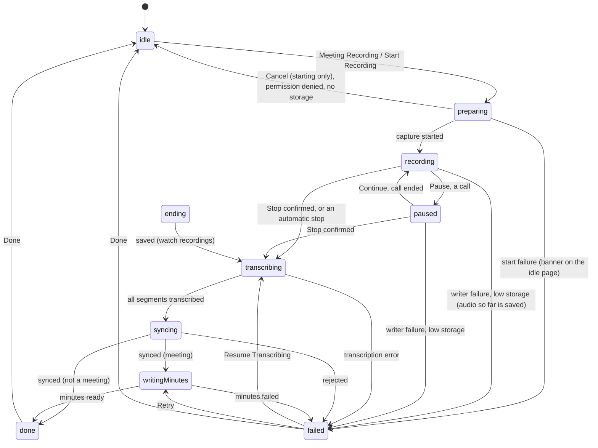

# Proposal: the iPhone meeting recording page, interaction and motion

Status: built (#4240) on iPhone: the live sheet, now-recording card, wrap-up, recording page and minutes polish, the Live Activity layout tweaks, and the DEBUG `-showMeetingSample flow`. Not built: scroll anchoring by id while the reader is detached (the unread count counts every new item since detaching), the follow-ups in section 14, and real-device checks of haptics and audio. Where the built code differs, `docs/apple/recording.md` is the reference. Line numbers in section 2 are as of the proposal's base commit `ac9fd51bf`; re-check them before implementing.
Covers the iPhone app only (`apple/Persona/Recording/`, one new token file in `apple/Shared/Design/`, the Live Activity layout
in `apple/PersonaWidgets/`). No hub, protocol, prompt or Android / web change. The new views are guarded `#if os(iOS)`; the visionOS
controls stay as today, and the Mac, Vision and watch targets must still build (section 15).

## 1. Goal and scope

**One sentence**: while a meeting is recorded the page shows what is being heard, lets the thumb reach Pause, Stop, Bookmark and Ask
without scrolling, and after Stop shows what happens to the recording until the minutes are ready, so nobody has to guess.

**In scope**: UI and interaction of the recording page and its sub-pages (idle page, live view, wrap-up, recording detail and
minutes), the motion and haptics of those, accessibility, and the layout of the Live Activity.

**Out of scope**: recording, transcription, sync, ask and minutes logic. These stay as they are: `RecordingCapture` behavior,
`RecordingSegmentWriter`, `RecordingLibrary`, `MeetingRecorder`, `MeetingLive`, `MeetingAsk`, `MeetingSpeaker`, `RecordingSync`,
`RecordingTranscription`, `MinutesRelay`, `RecordingActivity` content and the minutes model's fetch logic.

**The exceptions** (the PR names each):

1. A read-only accessor on `RecordingCapture` that forwards the writer's existing smoothed input level
(`RecordingSegmentWriter.level`, 0...1, `Shared/Recording/RecordingSegmentWriter.swift:64-65`), so the page can draw a level meter,
behind the same `#if` guard as `RecordingSegmentWriter` (the watch compiles `Shared/`). It reads a value that already exists and
   changes no recording behavior. It is open decision 3 (section 13); without it the page has no level meter.
2. A presentation serial in `MeetingRecorder.openRecordings()` (one line, a counter the sheet observes; section 4C). No recording
   behavior changes.
3. DEBUG-only members on `RecordingCapture` for the `flow` sample: a sample level and a sample stop (section 15). `state` and
   `recordingID` are `private(set)` and `stop()` needs a writer, so a sample cannot be stopped from outside.

Default in one sentence (principle 1): "tap Meeting Recording and a live view opens with the time, a level meter and the text as it
is transcribed; Stop asks first; after Stop the same view shows the steps up to the minutes".

## 2. Audit

### 2.1 Where the code is

Paths are under `apple/`. "R/" is `Persona/Recording/`. Line numbers are as of base commit `ac9fd51bf`.

| Part | Where |
| --- | --- |
| Hosts: Knowledge > Recordings | `Persona/Views/Knowledge/KnowledgeView.swift:77-79` (`RecordingsSection()` inside the list) |
| Host: the page of its own | `RecordingsPage`, `R/RecordingsSection.swift:313-337` (inline title "Recordings", `:323`); pushed from `AssistantView.swift:136` (`startMeeting`) and `:35` (`showRecordings`), and through the iPhone shell (`ShellState.show(.recordings)`) |
| Starters | drawer, `Persona/Views/Shell/ShellView.swift:118-128` (already recording: `go(.recordings)`; else `MeetingRecorder.startMeeting`); home-screen quick action, Control / Siri / Action button intents, Live Activity tap, "Recording Paused" notification; routed by `MeetingRecorder.openRecordings`, `R/MeetingRecorder.swift:165` |
| The section | `RecordingsSection`, `R/RecordingsSection.swift:10-63`: controls section with the privacy footer (`:20-32`), `MeetingAttendanceSection` while recording (`:25-31`), then "Recent Recordings" (count badge `:47`) |
| One list row and its status word | `RecordingRow` `:66`, `RecordingStatusText` `:86-113` |
| Idle and recording controls | `RecordingCaptureControls` `:117-309`: idle stack `:162-184`, starting `:185-187`, error and notice lines `:191-192`, `meetingStart` `:197-231`, `recordingNow` `:256-294`, `stop()` `:296` |
| Persona choice before start | `MeetingAttendanceStart` `R/MeetingAttendanceViews.swift:10-34` (segmented, label `:17-19`) |
| Persona while recording | `MeetingAttendanceSection` `:133-203` (role menu `:157-163`, last three exchanges `:178`), ask buttons `:207-256` (type alert `:216-227`, `askButton` `:230-242`), `MeetingExchangeRow` `:260-328`, `MeetingAttendeePicker` `:59-129` |
| Ask state | `R/MeetingAsk.swift`: `busy` `:98`, `ended` clears exchanges `:125-128` |
| Start path | `MeetingRecorder.startMeeting` `R/MeetingRecorder.swift:59` (calendar read before capture `:62`, `Haptics.success()` `:78`); `finishInBackground` `:147` |
| Capture | `Shared/Recording/RecordingCapture.swift`: `State { idle, starting, recording, paused }` `:14`, `interrupted` `:28`, writer private `:40`, `togglePause` `:219`, `stop()` `:280`, ticker `:319-331` (250 ms), segment length `:365-367` |
| Segment length | `RecordingAudioSpec.liveSegmentSeconds = 30`, `Shared/Recording/RecordingModels.swift:216` |
| Detail page | `RecordingDetailView` `R/RecordingsSection.swift:340-567` (nav title `:363`, header section `:386-412`, transcript `:418-431`, polling `:456-462`, jump `:468-476`), `RecordingMeetingFacts` `:570` |
| Minutes | `R/RecordingMinutesView.swift`: `RecordingMinutesSections` `:116-233`, waiting row `:147-157`, "Try Again" `:139`, time chip `:215`, copy haptic `:230` |
| Live Activity | `PersonaWidgets/RecordingLiveActivity.swift`: island `:18-67`, `RecordingMark` `:72`, `RecordingSubtitle` `:108`, buttons `:132-181`, Lock Screen `:203-240`; phone half `R/RecordingActivity.swift` (content `:51-70`, ends `.immediate` `:118`) |
| DEBUG samples | `R/RecordingSamples.swift`, launched by `PersonaApp.swift:258` (`-showMeetingSample recording\|paused\|interrupted\|listening\|taking-part\|answered\|minutes\|pending`) |
| Tests | `PersonaUITests/MeetingRecordingUITests.swift`, `MeetingAttendanceUITests.swift`; `PersonaTests/MeetingRecordingTests.swift`, `MeetingAttendanceTests.swift`, `RecordingTests.swift` |

There is no live transcript view on the phone while recording. Segments are transcribed into `entry.segments[].sentences`; the only
place to read them is `RecordingDetailView`, reached by tapping the active row in "Recent Recordings".

### 2.2 Problems

Evidence is a code location or a baseline screenshot, named "baseline screenshot: <step>, <appearance>". The screenshots are attached
to issue #4240 (not committed to the repository), so a reader can check them there. The baseline was captured
on an iPhone 17 Pro simulator with a mock hub; the simulator has no microphone, so real start, stop and wrap-up states were not
captured (section 15 covers this). Severity: P0 uncomfortable or confusing, P1 looks unfinished, P2 polish.

**Visual hierarchy**

- H1 (P0). The recording screen is the first section of a grouped list. Timer, controls, a four-line privacy footer, the Persona
  block and the recent list have the same weight, and the footer sits between the controls and the Persona block. Evidence:
  `RecordingsSection.swift:20-32`; baseline screenshot: recording, light (the privacy paragraph is the largest text block on the page).
- H2 (P1). The timer is `Theme.Font.title` with a small red word beside it; no dot, no level, and a paused recording looks the same
  except for the word. Evidence: `:264-271`; baseline screenshot: paused, light.
- H3 (P0). The idle page has two start buttons, a prominent "Meeting Recording" and a plain "Start Recording" row, between and
  below four settings (Persona role, attendee, language, microphone). The main action competes with settings. Evidence: `:162-184`;
  baseline screenshot: recordings empty, light.

**Information density**

- D1 (P0). No transcript on the page. Asking Persona "what was just said" is detached from the words it is about. Evidence:
  section 2.1 (no view reads `entry.segments` while recording).
- D2 (P1). After a meeting the detail page opens on a five-row metadata card and a three-line retention paragraph; the minutes sit
  below. The same time is formatted two ways in the card. Evidence: baseline screenshot: minutes, light (the second may be a mock
  data artifact; check the formatter, not assumed a bug); `RecordingsSection.swift:386-412`.
- D3 (P1). The recording being made is listed again in "Recent Recordings" as a row with a red "Recording" word. Evidence:
  baseline screenshot: recording, light (second row).

**Reachability**

- R1 (P0). Pause, Bookmark and Stop are three equal pills in a list row, not pinned; Stop sits next to Pause with no confirmation.
  Ask Persona is in another section below, and when answers accumulate the buttons stay above them and move. Evidence:
  `:280-288`, `MeetingAttendanceViews.swift:177-213`; baseline screenshot: taking part, light.
- R2 (P1). A typed question opens a system alert with a text field: modal, no meeting context. Evidence:
  `MeetingAttendanceViews.swift:216-227`. DESIGN_SYSTEM 4.4 keeps text entry as the system alert, so this stays (section 6).
- R3 (P1). Persona's role is edited in two idioms with two labels: a segmented control called "Persona in This Meeting" before the
  start, a menu called "Persona" while recording. Evidence: `MeetingAttendanceViews.swift:17-19`, `:157-163`.

**State feedback**

- S1 (P0). Stop has no ending state and no haptic. The page flips to the idle controls at once and the answers vanish. Evidence:
  `RecordingsSection.swift:162-190`, `MeetingAsk.swift:125-128`. The live behavior of a real stop was not captured; the code is the
  evidence.
- S2 (P0). Ask is not disabled while a question is pending, so repeated taps stack (the hub caps at two). `ask.busy` exists and
  the button does not read it. Evidence: `MeetingAsk.swift:98`, `MeetingAttendanceViews.swift:230-243`.
- S3 (P0). Start gives no feedback during the calendar read. The `.starting` state then replaces the whole block with "Waiting for
  microphone access" even when the wait is not the permission prompt. Evidence: `MeetingRecorder.swift:62`, `RecordingsSection.swift:185-187`.
- S4 (P1). After Stop, transcribing, syncing and writing the minutes show only as a colored word in a list row and a bare spinner
  on the detail page. Minutes "failed" is a red line plus a link-styled "Try Again". Evidence: `:86-113`, `:408`,
  `RecordingMinutesView.swift:139-157`; baseline screenshots: minutes failed, dark; minutes pending, light.
- S5 (P1). Errors (`capture.error`, `notice`) are one footnote line; a ticker stop caused by low storage just goes idle. There is
  no error haptic. Evidence: `:191-192`, `RecordingCapture.swift:324-326`.
- S6 (P2). Bookmark has no confirmation except a caption that grows below. Evidence: `:289-292`.
- S7 (P1). Copy contradicts itself: the button says "Stop", the footnote says "Tap End". Evidence: `:286` vs `:293`; baseline
  screenshot: recording, light.

**Motion**

- M1 (P2). There is no animation on the page. State swaps, the Persona block, exchange rows and the answer replacing its spinner
  are hard cuts. The only animations are the jump-to-line scroll and its highlight. Evidence: grep of `Persona/Recording` finds
  `withAnimation` only at `RecordingsSection.swift:470` and `:474`.
- M2 (P2). Nothing handles Reduce Motion (nothing moves yet; needed as soon as motion is added). Evidence: no
  `accessibilityReduceMotion` in `Persona/Recording`.
- M3 (P2). The 250 ms ticker re-evaluates the whole `recordingNow` body four times a second. Evidence: `RecordingCapture.swift:319-331`
  writes `elapsed`; `RecordingsSection.swift:266` reads it. Cost not measured.
- M4 (P2). Pause, Bookmark and Stop have no haptic on the page; only Ask and the start success do. Evidence: `:281-287` vs
  `MeetingAttendanceViews.swift:233`, `MeetingRecorder.swift:78`.

**Consistency with the rest of the app**

- C1 (P1). The detail page's nav title is "Record" while its parent is "Recordings" (a legacy name). Evidence: `:363` vs `:323`.
- C2 (P2). `Color.secondary.opacity(0.7)` on the count badge is a raw color; `CountBadge` exists. Evidence: `:47`.
- C3 (P2). Recording state uses `Theme.danger` (failure red) while the Live Activity uses `Palette.recordingRed`. DESIGN_SYSTEM 3.7 says
  red is for failure and destructive actions; the recording mark is a recording cue, so this needs a stated rule (section 12).
- C4 (P2). Several localization keys carry disambiguation suffixes shared with CarPlay (`"Stop [Car Play Voice Screen c7b24e]"`,
  `:286`), so rewording needs the catalog kept in step.
- C5 (P1). Live Activity: the paused mark is a 35 % red disc with a white glyph (`RecordingLiveActivity.swift:78`), low contrast;
  secondary text is regular weight (HIG_AUDIT HIG-079); the island subtitle truncates at the default size ("Meeting · 2 bookmar…").
  Evidence: baseline screenshot: Live Activity expanded island, recording, light. The paused and interrupted Live Activity were not captured.

**Accessibility, Dynamic Type, dark mode**

- A1 (P0). At the largest accessibility size the recording card breaks: the "Meeting" chip fills its row, the title becomes "…", the
  state word wraps inside the word, the buttons lose their labels and Stop is clipped, and a footnote dominates. Evidence: baseline
  screenshot: recording, accessibility extra-extra-extra-large, light. Code: no accessibility-size layout in the button row `:280-288`
  (only the ask buttons switch at `MeetingAttendanceViews.swift:209`).
- A2 (P1). At the default size on a 6.3 inch phone the labels truncate ("Pau…", "Boo…") while the icon pads are wide. Evidence: baseline
  screenshot: recording, light.
- A3 (P1). The timer is read as the raw clock text, has no spoken label and no `.updatesFrequently` trait; start, stop, pause,
  bookmark and answers are not announced. Evidence: `:266`; no `AccessibilityNotification` in `Persona/Recording`.
- A4 (P1). The detail page breaks at the same size (truncated meta line, tiny controls). Evidence: baseline screenshot: recording
  detail, accessibility extra-extra-extra-large, light. The start page at this size was not viewed by the author of this proposal.
- A5 (P2). Dark mode: the page uses system and theme colors and no hex values; the gray footnotes have the lowest contrast on the
  dark background but stay readable. No contrast ratio was measured. Evidence: baseline screenshots: taking part, dark; recording, dark.
- A6 (P2). The detail transcript uses `ForEach(Array(...enumerated()), id: \.offset)` (`:422`, `:505`): index identity, fine for
  appends, poor for animation. Time chips on minutes are small tap targets (`RecordingMinutesView.swift:215`, HIG-013 family).

Not confirmed, not claimed as defects: "an answer arrives with no loading state" (the mock answers instantly), "layout jumps when an
exchange arrives" (code shows no animation; the video was not examined for this), and the minutes metadata formatting above.

## 3. References

Marking: **[V]** verified by reading the source (the HIG pages were read through Apple's JSON endpoint and summarized, so wording is
close to the page, not byte-exact); **[S]** taken from a search result snippet or a third-party article that was not read in full;
**[G]** general knowledge, not verified. A borrowed idea marked [G] is a hypothesis the implementation checks on a device.

| Source | What is borrowed and why | Marks |
| --- | --- | --- |
| Apple Voice Memos. [Make a recording](https://support.apple.com/guide/iphone/make-a-recording-iph4d2a39a3b/ios) | A level display proving the microphone hears; the Dynamic Island with Stop. Not borrowed: a full-screen waveform, because a meeting needs the screen for text, and the record button morph (it rests on [G] knowledge only and the sheet has no start button to morph from). | Waveform, time, pause and the Island Stop **[S]**. The morph, its timing and the layout **[G]** (unverified, not relied on) |
| iOS Notes recording and transcription. [MacRumors how-to](https://www.macrumors.com/how-to/ios-record-audio-transcribe-notes-app/), [9to5Mac](https://9to5mac.com/2024/08/01/audio-transcription-in-ios-18-how-to/) | Done as the single exit; transcript highlighting in playback (a follow-up here). Differs on purpose: Notes keeps the transcript behind a toggle, we show it by default because live text is the value. | Live transcript behind a button, updates as you talk **[S]**. "Transcript is a toggle by design" **[G]** |
| Otter.ai. [Chat during a live meeting](https://help.otter.ai/hc/en-us/articles/15113851067415-Using-Otter-Chat-during-a-live-meeting) | Ask scoped to the meeting's own text. A "jump to live" pill that appears once the reader scrolls away, with a count of new lines. | Scoped ask, live transcript followed in the apps **[V]** (help page, not a mobile statement). Auto-follow, pill and its wording **[G]** |
| Granola. [How it works](https://www.granola.ai/blog/can-ai-listen-to-a-meeting-and-take-notes) | A calm, small, always-visible recording cue instead of a loud control; generated text marked apart from the user's own. | On-device capture, small indicator, user vs generated text **[V]**. Transcript hidden behind a secondary view, in-place "enhancing" animation **[G]** |
| Fireflies. [Notepad guide](https://guide.fireflies.ai/articles/6653885315-learn-about-the-fireflies-notepad) | Bookmarks during recording that appear in the minutes; an index to jump to sections of long minutes (follow-up). | Notepad parts, bookmarks, Index **[V]**. Phone tabs layout **[G]** |
| Tencent Meeting. [Changelog](https://meeting.tencent.com/support/version/) | "What was just said" as a recap chip, an entry point that beats an empty text field in a meeting. Persona already has the tap-to-ask "what was just said"; the chip row for 1 / 3 / 5 minutes is a follow-up. | Live per-speaker transcript, recap of the last 1 / 3 / 5 minutes **[S]**; asking a recording **[V]** (changelog) |
| Feishu Minutes. [Article](https://www.feishu.cn/content/article/7594772423082396858) | The recorder survives leaving the page (here: the now-recording card and the Live Activity); minutes as layers, each with a next action (follow-up for to-dos). | Floating window when leaving, live transcript, summary, to-dos **[S]**; the 4 hour cap **[S]**, third-party claim |
| Just Press Record. [App Store](https://apps.apple.com/us/app/just-press-record/id1033342465) | One dominant start with nothing required before it, so the first seconds are not lost; elapsed time on the lock screen. | One-tap promise, lock screen widget, transcription failures reported by users **[S]** |
| HIG: [Live Activities](https://developer.apple.com/design/human-interface-guidelines/live-activities) | Important information at a glance, medium weight or heavier; Live Activities are visible to onlookers, so no transcript text on the Lock Screen; compact leading dot, trailing time; end the activity when the task ends; one simple action. | **[V]** (the "end immediately" and the 15-30 minute dismissal are on the page; applying them to minutes is our product call) |
| HIG: [Motion](https://developer.apple.com/design/human-interface-guidelines/motion) | Purposeful, brief, optional motion; avoid animating frequent interactions; motion is never the only carrier of information. | **[V]** |
| HIG: [Playing audio](https://developer.apple.com/design/human-interface-guidelines/playing-audio) | Handle interruptions explicitly; never resume the microphone silently without a visible action (the existing "Paused by a call" state already resumes by itself when the call ends; we keep that behavior and make it visible). | **[V]** that interruptions need a decision; the privacy reading is **[G]** |
| HIG: [Playing haptics](https://developer.apple.com/design/human-interface-guidelines/playing-haptics) | Sparse, causal haptics; a haptic must not disturb microphone use. | **[V]** |
| HIG: [Feedback](https://developer.apple.com/design/human-interface-guidelines/feedback) | Status near the thing it describes; confirm completion only for significant tasks; surface failures with a next step. | **[V]** |
| HIG: [Accessibility](https://developer.apple.com/design/human-interface-guidelines/accessibility) | 44 pt targets, text scaling to at least 200 %, visible alternatives to gestures, Reduce Motion rules (fades instead of slides, no zoom). | **[V]** |
| HIG: [Buttons](https://developer.apple.com/design/human-interface-guidelines/buttons) | One or two prominent buttons per view; use style, not size; never make a destructive action the primary one. | **[V]** |
| Repo: `docs/design/DESIGN_SYSTEM.md`, `PRINCIPLES.md`, `HIG_AUDIT.md` | Tokens only (2.x), buttons (3.7), sheets (3.6), confirmation ladder (4.4), haptics (4.3), content (5.x), accessibility baseline (6.3); HIG_AUDIT items this work touches: HIG-042, 043, 048, 070, 079 (section 8 maps each haptic to its meaning for 070). | **[V]** (this repository) |

Not verified anywhere in this proposal: exact Voice Memos timings, Notes and call-recording layouts, anything new in iOS 26 for
those apps, Otter's exact pill wording. Check them on a device before any of them is quoted as fact.

## 4. Page structure

Six parts, A to F. The idle page and the recording detail are pages in the app's navigation; the live view and the wrap-up are one
sheet that changes content.

### A. Recordings page, idle

The same `RecordingsSection` rows, hosted by Knowledge > Recordings and `RecordingsPage`.

```
┌───────────────────────────────┐
│  < Recordings                 │
│                               │
│ ┌───────────────────────────┐ │
│ │  (mic)  Meeting Recording │ │  prominent, full width, id recording-meeting-start
│ └───────────────────────────┘ │
│  Weekly sync · 10:00-11:00    │  calendar line (or the hint)
│                               │
│     Start Recording           │  quiet borderless secondary right under it, id recording-start
│                               │
│ ┌───────────────────────────┐ │
│ │ Persona          Listen v │ │  menu, same control while recording
│ │ Persona listens, answers  │ │  explanation, only when Persona attends
│ │ Who Attends    Main chat >│ │  only when attending
│ │ Recording Language  EN  v │ │
│ │ Microphone     Bluetooth v│ │  only with Bluetooth
│ └───────────────────────────┘ │
│  Audio stays on this device…  │  one-line footer, idle only
│                               │
│ Recent Recordings        2    │
│  ...                          │
└───────────────────────────────┘
```

While the start is in flight (calendar read, then microphone) the button keeps its label, shows a spinner beside it and is
disabled (HIG-042). `.starting` shows "Starting…" and Cancel (`capture.cancelStarting()` acts only in that state); the calendar
read before it has no Cancel. "Waiting for microphone access" is only a detail line, shown when that is the wait.

### B. The now-recording card

While `capture.state != .idle` the controls are replaced by one tappable row, and the active recording is left out of "Recent
Recordings".

```
┌───────────────────────────────┐
│ (●)  Weekly sync       12:34  │
│      Recording             >  │  tap: opens the live view
└───────────────────────────────┘
```

The card shows a recording dot (a pause glyph when paused), the title, the running time, the state word and a chevron. The privacy
footer is not shown while recording.

### C. The live view (`RecordingLiveSheet`, new file, iOS only)

A `.sheet`, `.presentationDetents([.large])`, drag indicator visible, with its own `NavigationStack` (for Who Attends). A header
button "Hide" closes it; recording continues. ("Done" is kept for the wrap-up, where it means "finished, work goes on in the
background"; a "Done" while recording would suggest the recording is over.)

**This is a new pattern, not a reuse of DS 3.6** (ordinary detent and busy sheets). It opens by itself, survives dismissal, owns a
navigation stack and swaps its content to the wrap-up. Reason: the recording must stay one tap away on whatever page the user is on,
without becoming a new primary destination (DS 4.1). The alternative is a pushed page (open decision 2). The PR adds the pattern to
`docs/design/DESIGN_SYSTEM.md` (principle 4).

**Who presents it.** The sheet is presented by one modifier, `.recordingLiveSheet()`, applied by both hosts to their whole `List`
(Knowledge's list and `RecordingsPage`), not to `RecordingsSection` (which is only a few `Section`s with no stable view, and which
Knowledge removes when the kind chip or search changes while recording goes on). It presents on three signals:

1. `capture.state` becoming `.recording` while the host is visible. This is the observed transition, not "tapped here": the
   drawer, Siri and quick-action paths call `openRecordings()` before the calendar read and `capture.start`, so the page is already
   visible and idle when recording begins.
2. A new presentation serial (a counter, like `ShellState.request`) bumped in `MeetingRecorder.openRecordings()`; the modifier
   presents on every change while `capture.state != .idle`. Needed because a Live Activity tap, notification or drawer entry while
   Recordings is already on screen with the sheet swiped away runs `backToRoot()` and `showRecordings = true` in one pass: the page
   stays and `onAppear` never fires. This serial is the second logic-adjacent exception (section 1).
3. The host appearing while a recording runs.

Swiping the sheet down or Hide keeps recording and leaves the now-recording card. The new views are `#if os(iOS)`; on visionOS
`RecordingsSection` keeps today's controls (the Mac app is frozen and compiles none of this; section 15 builds it).

```
┌───────────────────────────────┐
│            ───                │  drag indicator
│  Weekly sync          [Hide]  │  title (2 lines max), Hide
│  [Meeting]  (●) Recording     │  chip, state line: dot + word
│                               │
│          12:34                │  timer, large, monospaced digits
│   ▂▃▅▇▅▃▂▃▅▆▄▂▁▂▃▅▃▂          │  level meter (hidden from VoiceOver)
│ ┌───────────────────────────┐ │
│ │ ✦ Persona is listening  ⋯ │ │  Persona strip, only if the hub offers attending
│ └───────────────────────────┘ │
│  0:31  Let's start with the   │  timeline: ONE stream, newest at the bottom
│        release plan…          │
│  0:58  The API change lands   │
│        next week.             │
│  ── Transcribing the last 40 s│  gap marker (section 9)
│  ▸ Bookmark 1:05              │  bookmark marker
│  You · 1:10 What was just said│  Persona exchange at the time it was asked
│  ✦ They agreed on…  From: …   │
│                  [ v 2 new ]  │  Jump to Latest, appears only when scrolled up
│ ┌──────────────────────┬────┐ │  pinned bottom bar
│ │     Ask Persona      │ ⌨  │ │  row 1, only when Persona attends; the only solid control
│ └──────────────────────┴────┘ │
│  [ Pause ] [ Stop ] [Bookmark]│  row 2: three standard-weight buttons
└───────────────────────────────┘
```

1. Header: title, "Meeting" chip, state line, Hide. State is never color alone: the dot becomes a pause glyph when paused, and
   the word changes ("Recording", "Paused", "Paused by a call").
2. Timer: a `Theme.Font.display`-class token with `.monospacedDigit()`, drawn with `Text(timerInterval:)` while running so the page
   does not re-render four times a second; a frozen `elapsed` while paused. No `numericText` transition on it (it changes every
   second; HIG Motion says not to animate frequent changes). Spoken value: section 11.
3. Level meter: a row of bars of **fixed height**, each drawn with `scaleEffect(y:)` anchored at the bottom (or one `Canvas`), so
   the loop changes only a transform and never a frame (`docs/apple/ios.md` red line). The pose function maps level to a scale per
   bar. It lives in `RecordingLevelMeter.swift` (named in `ContinuousMotionTests`), reads the forwarded level inside a
   `TimelineView` closure (the `VoiceOrb` pattern), at most 30 fps. Paused: bars flatten and dim. Reduce Motion or Low Power: one
   still frame. Off screen or in the background: stopped.
4. Persona strip: one row, "Persona is listening / taking part / off", with a menu (the role choices and "Who Attends…"). A
   problem shows under it as a `NoticeBanner`.
5. Timeline: the rest of the height, scrolls. One time-ordered stream of transcript sentences (time and text), bookmarks (small
   inline markers) and Persona exchanges (question, "Persona is looking…", answer and sources, Speaking / Stop Speaking,
   failed and Retry) at the time they were asked. The stream is not append-only; section 9 defines how arrivals are placed.
6. Bottom bar: pinned with `.safeAreaInset(edge: .bottom)`, always reachable, never scrolls (the large-type layout below keeps
   it that way). Ask Persona is the **only solid, prominent control** (DS 3.7: one per group).
   - Row 1, only when Persona attends: "Ask Persona" full width (id `meeting-ask`), a round keyboard button beside it
     (id `meeting-ask-type`; it opened a text-entry alert, since #4486 an inline question row in the bar, DESIGN_SYSTEM 4.4). Ask shows a busy label and is disabled while `ask.busy`.
   - Row 2: Pause / Continue (left), Stop (center), Bookmark (right): three standard-weight buttons, icon over label, each at least
     44 pt. Stop is a constant `stop.fill` icon in the neutral button style, not a red fill and not a morphing record button
     (Voice Memos' morph rested on unverified knowledge, section 3, and the sheet has no start button for it to morph from). Pause
     / Continue swaps its glyph (pause, play). Stop's paused look is the same as its recording look.
7. Stop asks first (verb: **Stop**, everywhere: control, accessible name, dialog, edge labels). `confirmationDialog` titled
   "Stop Recording?", destructive button "Stop Recording" (repeats the verb, DS 4.4 rung 2), Cancel; message "The audio is saved
   on this device and its text goes to Knowledge. A stopped recording can't be continued." What is lost is the ability to continue
   the meeting; nothing recorded is lost, which is why the page control itself is not red and the destructive styling sits only
   on the dialog's button. The old footer "Tap End when you're done" is removed (S7).

   Every way to stop, and whether it asks (deliberate split: the page bar sits next to Pause and Bookmark, so a mis-tap there
   needs a guard; the others are explicit invocations from a system surface with no room for a dialog):

   | Entry | Behavior |
   | --- | --- |
   | The page's Stop | asks first |
   | Live Activity Stop (Lock Screen, Island) | one tap, unchanged |
   | Control, Siri, Action button, "Recording Paused" notification | as today and unchanged here; not re-checked for this proposal |
   | Automatic (low storage, writer failure, media-services reset) | no choice; goes to the wrap-up with the reason |

**How the sheet follows a stop it did not start.** `RecordingCapture.stop()` is also called by the ticker and by a media-services
reset, and it sets `recordingID = nil` and `.idle` at once; `capture.onStopping` is already taken by `MeetingAsk.ended`. So the
sheet remembers the recording id while `capture.state` is `.recording` or `.paused`, and treats the observed change to `.idle` as the
stop. `MeetingAsk.ended` clears the exchanges at that instant, so the sheet snapshots its timeline (including exchanges) when it
sees the stop and cross-fades from the snapshot.

### D. The wrap-up (same sheet, after Stop)

The sheet stays open and its content cross-fades to a wrap-up for the remembered recording id.

```
┌───────────────────────────────┐
│            ───        [Done]  │  Done closes; the work goes on in the background
│  (✓)                          │  spinner until it is saved, a check once it is
│  Weekly sync                  │  large title
│  Recorded 42:10               │
│                               │
│  ✓ Saved                      │
│  ✓ Transcribed                │
│  ◌ Syncing to Knowledge       │  current step: spinner (done: "Synced to Knowledge")
│  · Writing minutes            │  meetings only
│  · Minutes ready              │
│                               │
│ [      Open Minutes       ]   │  the one solid button; "Open Recording" without minutes
└───────────────────────────────┘
```

Steps are derived from existing state (section 5). On the phone, `stop()` saves finished segments synchronously, so "Saved" is
already done when the wrap-up appears; it is a checked row, not a step the user waits for. A done step has a check; the current step
has a spinner; a failed step shows its reason. Retry exists only where an action exists today: "Resume Transcribing" (transcription)
and "Retry" (minutes). A rejected sync shows its reason and no button (no such action exists, and new sync logic is out of
scope; a follow-up, section 14). If the hub is unavailable (not paired, demo mode, offline), the "Syncing to Knowledge" row reads
"Waiting for the hub" with no spinner and the steps after it stay unstarted, so the wrap-up never spins forever.

The wrap-up owns its own `RecordingMinutesModel` instance and its own polling task (every 15 s, like
`RecordingDetailView.followMinutes`; the model fetches `GET /api/v1/kb/recordings/{id}` and calls `MinutesRelay.note` as a side
effect, as the detail view does). The task starts when the wrap-up appears and is cancelled when the sheet closes. "Open Minutes" /
"Open Recording" pushes `RecordingDetailView` inside the sheet's stack. The sheet holds only the recording's UUID.

### E. Recording detail and minutes

Nav title "Recording" (was "Record"). A compact header (title, one meta line, facts) and the minutes directly after it. The
retention paragraph moves to the bottom footer. "Writing the minutes…" is a clear row with a spinner. Failed uses a
`.themedButton()` labelled "Retry" (DESIGN_SYSTEM 5.x wording) with the reason. Minutes sections animate in with `Theme.Motion.reveal` when they arrive.
Time chips get a 44 pt hit area. Transcript rows keep stable ids. Copy and Share are unchanged.

### F. Live Activity and Dynamic Island

`RecordingActivityAttributes.ContentState` does not change (system identity; logic tests cover it). Layout only: the paused and
interrupted marks get enough contrast to read in the compact island (the mark already swaps its glyph, `RecordingLiveActivity.swift:78-80`; the
35 % red disc is the weak part), secondary text at medium weight (HIG-079), and a shorter subtitle that no longer truncates at
the default size. Section 10 has the rest.

### The large-type layout

The bottom bar stays pinned at every size and holds only the primary actions, so Stop is reachable without scrolling. At
accessibility sizes (`dynamicTypeSize.isAccessibilitySize`) the bar is Ask Persona (when attending) full width, and under it
Pause / Continue, Stop and a "More" menu (Bookmark, Type a Question) side by side as icons whose names are their accessibility
labels, so the bar is two rows tall at any size and Pause stays one tap away. The header is one fixed line (the mark, the time
and Hide) above the scroll view, so the state and the time are on screen at any size; under it the title, state, Persona strip
and timeline scroll as one view.

```
┌───────────────────────────────┐
│  (●) 12:34            [Hide]  │  fixed header, one line
│  Weekly sync                  │  title wraps (this and below scroll)
│  [Meeting]                    │  chip on its own line
│  Recording                    │  state word on its own line
│  0:31 Let's start with the    │  timeline wraps freely
│  release plan…                │
├───────────────────────────────┤  pinned bar
│ │       Ask Persona         │ │
│ │  [ || ]   [ Stop ]  [ … ] │ │  icons; … holds Bookmark, Type a Question
└───────────────────────────────┘
```

The bar is Ask Persona and one row of three icon buttons; none has a label that could wrap.

## 5. State machine

`RecordingPhase` (new, `nonisolated`, in `apple/Persona/Recording/`) is a pure function of inputs that already exist and are
observable. It adds no state to the recording code. The sheet remembers the wrap-up recording as a UUID (section 4C). "failed" is the
error state: it names the reason and the one next step.

| Phase | Derived from | The user sees | The user can | Leaves to |
| --- | --- | --- | --- | --- |
| idle | `capture.state == .idle`, no wrap-up recording held | start hero (A) | start a meeting, start a plain note, change options | preparing |
| preparing | start tapped and not yet recording (a local flag, covers the calendar read), or `capture.state == .starting` | button keeps its label with a spinner; "Starting…" | Cancel, only in `.starting` (`capture.cancelStarting()` acts only then; during the calendar read there is nothing to cancel) | recording, idle, failed |
| recording | `capture.state == .recording` | live view (C), running timer, moving meter | Pause, Stop, Bookmark, Ask, change Persona | paused, transcribing (Stop; see below), failed |
| paused (byCall: Bool) | `capture.state == .paused`, `capture.interrupted` | live view, frozen timer, flat meter, "Paused" or "Paused by a call" | Continue, Stop, Bookmark | recording, transcribing, failed |
| ending | wrap-up recording held, entry `active` or not all segments received | wrap-up, "Saved" in progress | Done | transcribing |
| transcribing | `!entry.transcribedAll` (current or queued) | step "Transcribed" in progress | Done | syncing |
| syncing | sync status `pending` or `uploading`, or minutes `.waitingForSync` (the text is not on the hub yet) | step "Syncing to Knowledge" in progress; sub-state "Waiting for the hub" (no spinner) when not paired, in demo mode or offline | Done | writingMinutes, done |
| writingMinutes | minutes model `.writing` only (meetings) | step "Writing minutes" in progress | Done | done |
| done (hasMinutes: Bool) | minutes `.ready`, or a non-meeting synced, or minutes `.unsupported` / `.none` | all steps checked; "Open Minutes" or "Open Recording" | Open, Done | idle (after Done) |
| failed (reason) | `capture.error` or a start failure, a transcription error, sync rejected, minutes `.failed` | the step that failed and its reason | "Resume Transcribing" (transcription) and "Retry" (minutes) only; a rejected sync or a capture error shows the reason with no action; Done | the step retried, idle |

`ending` is not observable for any real time on the phone: `stop()` saves all finished segments and sets `active = false`, the
expected segment count and `endedAt` before it returns, so on the phone the wrap-up starts at `transcribing`. `ending` is reachable
only for watch recordings, and the wrap-up shows "Saved" in progress there.



Rules: the phases after `ending` can be skipped when they are already satisfied (a short note that is transcribed at once goes
straight on). A step never goes backwards on screen except through Resume Transcribing or Retry. A recording that fails
while recording (storage, writer) shows the failure in the sheet and goes to the wrap-up, because the audio so far is saved. A start
failure never opens the sheet: the idle page shows a banner.

## 6. Interaction per state

- **idle**: the hero button starts a meeting; Persona's role, language and microphone are single rows; "Start Recording" is the
  secondary button for a plain note. Permission denied shows an inline `NoticeBanner` with an "Open Settings" action instead of a
  dead button (HIG-071). The calendar line updates every 60 s as today.
- **preparing**: the hero is disabled with a spinner and keeps its label. Cancel appears only once the state is `.starting`
  (the calendar read before it has nothing to cancel). No other control changes, so nothing jumps. The `success` haptic of
  `MeetingRecorder` fires when recording has started, once (section 8).
- **recording**: the sheet is open (unless swiped away). Pause and Bookmark act at once; Stop opens the confirmation. Ask
  Persona asks "what was just said"; the keyboard button opens the system text-entry alert (DESIGN_SYSTEM 4.4; no second
  composer). While `ask.busy` (any exchange is still `.asking`) Ask shows a busy label and is disabled. This is deliberately
  stricter than the hub, which allows two pending asks: one at a time keeps the timeline calm and the answer next to its question.
  The Persona menu changes the role; Who Attends pushes the existing picker.
- **paused**: the timer freezes, the meter flattens; "Paused by a call" explains that it continues by itself when the call ends or
  when the user comes back to Persona (existing behavior), and Continue is always there.
- **ending to done**: the wrap-up. Done closes the sheet and everything continues in the background. Failed steps keep their
  existing action where one exists. Leaving never cancels work.
- **failed while open**: the failure is a `NoticeBanner` or the failed step, with the reason and the next step where there is
  one; a start failure stays on the idle page as a banner.
- **Persona exchanges** now stay in the timeline for the whole recording (not only the last three, not under the buttons) and are
  announced when they arrive. At Stop the sheet snapshots them for the cross-fade; after that they are no longer shown
  (`MeetingAsk.ended` is logic and stays; see section 14).
- **The sheet swiped away**: recording continues; the now-recording card is the way back, and Live Activity / drawer / Siri
  entries reopen the sheet through the presentation serial (section 4C).

## 7. Motion spec

All durations and curves go through tokens. New tokens live in a new file, `RecordingTokens.swift`, in the `Shared/Design` folder (`nonisolated`, like
`VoiceTokens.swift`, because `Shared/` also compiles for the watch) and each gets a row in the Motion table of `docs/apple/ios.md`.
Curves are system springs and the existing `snappy` / `smooth` / ease families; no custom bezier.

| Moment | Token | Duration and curve | Reduce Motion |
| --- | --- | --- | --- |
| Sheet rises, auto-opens, is dismissed | system sheet | system spring | system |
| Idle hero swaps to the now-recording card and back | `Theme.Motion.state` (exists) | `.snappy(duration: 0.25)`, cross-fade with a small offset | cross-fade only |
| Busy spinner appears on the hero button | `Theme.Motion.state` | 0.25 s, opacity; the label does not move | at once |
| Error banner arrives or leaves | `Theme.Motion.reveal` / `conceal` | 0.28 s in, 0.2 s out, opacity plus a small offset | opacity only |
| State line, header and bar glyph swaps (Pause to Continue) | `Theme.Motion.state` | `.snappy(duration: 0.25)` | cross-fade only |
| A timeline item arrives | `Theme.Motion.reveal` (exists) | 0.28 s ease-out, opacity plus a small offset; a chunk of sentences arrives as one group (section 9) | opacity only |
| An item leaves; wrap-up replaces the live view | `Theme.Motion.conceal`, then `reveal` | 0.2 s ease-in, then 0.28 s ease-out (leaving is quicker) | cross-fade |
| Jump to Latest appears and leaves | `Theme.Motion.reveal` / `conceal` | opacity plus a small vertical offset; no scale (a panel or pill leaving does not shrink) | opacity |
| Level meter | `Theme.Motion.recordingLevelFrame` (new) | 1/30 s timeline; `scaleEffect(y:)` on fixed-height bars | one still frame |
| Recording dot | the existing `holdBlink` | 0.5 s ease-in-out each way | steady dot |
| Wrap-up step completes | `Theme.Motion.state` with `contentTransition(.symbolEffect(.replace))` | 0.25 s | at once |
| Counts (bookmark count, new-lines count) | `.contentTransition(.numericText())` | system | at once |

Rules this follows: leaving is quicker than arriving; nothing animates under the finger (a drag on the timeline is never fought
by an animation); loops touch only transform, opacity and color; Reduce Motion means still, not slower. Which of this is checked
by a test: only the loops (the meter, the dot), through `ContinuousMotionTests` (DS 1.3 and 2.7). Transitions, swaps and press
feedback are review-only (screenshots and the Reduce Motion run in section 15). Tokens do not gate themselves (DS 2.7), so every
`withAnimation` and `.animation` on this page is gated on Reduce Motion, through one small helper in the design system (HIG-043).
A moving meter is ambient: it stops when the sheet is off screen, in the background and in Low Power Mode. There is no record-button
morph (section 4C item 6), so no `recordMorph` token.

## 8. Haptics

Through the existing `Haptics` helper. Haptics are not gated by Reduce Motion (iOS has no per-app switch). The meaning of each
follows DS 4.3's mapping (HIG-070): `tap` for a toggle or selection, `success` for a completed outcome, `error` for a failure.
`Haptics` is a no-op on visionOS.

The risk comes first: the HIG says a haptic must not disturb a feature that uses the microphone **[V]**, and any motor pulse while
the microphone is open can be picked up, a `success` or `error` pattern more than a light `tap`. So while the microphone is open
(`.recording`) the table has only the minimum, and everything that can wait for the visual change does.

| Event | Haptic and order |
| --- | --- |
| Start succeeded | `success` (already in `MeetingRecorder`; not doubled); fires before the microphone opens |
| Pause | `tap`, fired after `writer.pause()` has returned, so the microphone is already paused (`togglePause` pauses inside the action; a tap on touch-down would overlap live capture) |
| Continue | `tap`, fired before `togglePause` reopens the microphone |
| Bookmark | `tap` while the microphone is open: the one at risk, covered by the device check; plus the marker appearing in the timeline |
| Ask | `tap` (exists today); also covered by the device check |
| An answer arrives, or any failure, while recording | none. The visual change and the announcement carry it (section 11) |
| An answer or a failure after capture has ended (wrap-up, idle) | `success` / `error` |
| Stop confirmed | `success`, when the wrap-up appears, after capture has ended |
| Jump to Latest, menu choices | none |

Section 15 has a device check: record a meeting, trigger every haptic that can fire while recording (Bookmark, Ask, and Pause and
Continue around the pause), and listen to the saved audio. The fallback is to drop any haptic that is audible, and rely on the visual
change. Nothing in this table is marked safe until that check is done.

## 9. Live transcript scrolling and auto-follow

**What the text is, honestly.** Sentences arrive per finished audio segment. In the foreground a segment is 30 s
(`RecordingAudioSpec.liveSegmentSeconds`, `RecordingModels.swift:216`; longer in the background, `RecordingCapture.swift:365-367`),
so new text appears about every half minute, in chunks of a few sentences, after the segment is transcribed on the device.
That is not live captioning. Before the first sentence the area says: "Listening… Text appears here about every half minute." The
page promises no more than that.

**Why word-by-word text is a follow-up.** It needs partial (volatile) results from the speech recognizer written through the
transcription and library path, and a rule for replacing partial text in place. That is transcription logic, outside this issue
(section 14). Whether `RecordingSpeech` can emit partial results was not checked.

**Follow rules** (the pattern in `LarkFollow` and `defaultScrollAnchor(.bottom, for: .sizeChanges)`, reused rather than rebuilt):

1. The timeline sticks to the newest item while the reader is at the bottom.
2. The first drag upward stops following. A programmatic scroll never counts as a drag.
3. While detached, a round "Jump to Latest" button appears at the bottom right (same look and transition as the chat's), with a
   count of items that arrived since. Tapping it scrolls to the end and follows again; reaching the end by hand does the same.
4. A new item while following appears with `reveal`; under Reduce Motion the scroll jumps and the item fades.
5. Ids and placement. `RecordingSentence` has no id, so one is synthesized: segment index plus start time (stable across
   appends; it changes on re-transcription, which is accepted). Sentences only exist after a segment closes and is transcribed
   (about 30 s foreground, 60 s background), while a bookmark is stored at once and an exchange is stamped when it is asked, on the
   same writer clock. So the stream is not append-only, and the rule is: items newer than the last transcribed sentence sit
   **below a gap marker** ("Transcribing the last N s") in arrival order, and never between transcribed sentences. When the
   segment lands, its sentences arrive as one group above the marker, the marker's items re-sort by time, and the marker moves or
   goes. The group animates once with `reveal`. While the reader is detached the scroll position is anchored to the row at the top
   of the viewport (`scrollPosition` by id), and the "N new" count counts items inserted below that anchor. Sentences spoken by
   Persona itself are filtered out (`attendance.spokenBy`), so a row can disappear after appearing; this is accepted and not animated
   under the finger.
6. The follow and unread logic are a pure function with unit tests (section 15).
7. VoiceOver: transcript lines are an ordinary readable list and are not announced one by one; arriving Persona answers and state
   changes are (section 11).

## 10. Lock Screen and Dynamic Island plan

**Changes now (layout only, `PersonaWidgets/RecordingLiveActivity.swift`, `RecordingActivity.swift` content untouched).** What each
region shows, with the new subtitle wording (subtitle strings are existing ones except the shortened bookmark form):

| Region | Shows | Changes |
| --- | --- | --- |
| Compact leading | the mark: red dot (recording), a pause glyph on a strong fill (paused, interrupted) | the weak 35 % disc (`:78`) gets a stronger fill |
| Compact trailing | the time, `Text(timerInterval:)` | stays visible when paused; medium weight |
| Minimal | the mark | same stronger fill |
| Expanded leading / trailing | mark; time in the corner | unchanged placement |
| Expanded bottom | name; subtitle; last answer when there is one; Bookmark and Stop (Ask Persona first when attending) | subtitle shortened and at medium weight, never truncated at the default size; Stop stays one tap |
| Lock Screen | mark, name, subtitle, time; the same buttons | secondary text at medium weight or heavier (HIG-079); within the roughly 160 pt budget |

Subtitle: recording shows "Meeting" plus "2 bookmarks" as `Meeting · 2` with a bookmark glyph, or the full words when they fit;
paused shows "Paused"; interrupted shows "Paused by a call" with "Open Persona" only in the expanded and Lock Screen forms; Persona
attending shows "Persona listening / taking part". Voice Memos' own Island layout is not described: it was not examined here.

Every layout change gets a screenshot (the Lock Screen is clipped beyond the `.large` cap without a message,
`docs/apple/live-activity.md`), in light and dark, for recording, paused and interrupted; the baseline has only recording, light.

**Needs `ContentState` changes, so it is follow-up, not built here:** an "ended, writing minutes" phase and a "minutes ready" end
state with a deep link (the HIG says to end the activity when the task ends and allows a short dismissal period **[V]**, so
whether it spans minute generation is a product decision); a Pause / Continue button (a new App Intent); a "last line" or status
text.

**Privacy**: no transcript text on the Lock Screen or in the Island. A Live Activity is visible to onlookers **[V]** and a meeting
is sensitive. The page's transcript never goes into `ContentState`. The existing last answer (at most 160 characters) is already in
`ContentState`; whether it should stay is raised in section 14 rather than changed here. The level is not pushed through the activity
(it would burn the update budget **[G]**); the time stays `Text(timerInterval:)`, so a running recording sends no updates.

## 11. Accessibility

- Every control has a spoken label; the verb is Stop in the control, its accessible name, the dialog and the destructive button.
- The timer has the label "Recording time" and a value as a duration ("2 minutes 5 seconds", the spoken form, not the raw clock).
  The visible time is system-driven (`Text(timerInterval:)`) and does not re-render, so the spoken value is refreshed by a
  once-a-minute `TimelineView(.periodic)` that sets `accessibilityValue` from the elapsed time; it is not marked
  `.updatesFrequently`, and the value is at most a minute old (the state announcements and a fresh read when focused cover it).
- State changes (started, paused, continued, ended, bookmark added; "Recording started" when the sheet first sees the recording) and arriving Persona answers are announced with
  `AccessibilityNotification.Announcement`. Transcript lines are not.
- The level meter is hidden from VoiceOver.
- State is never color alone: dot shape and word; Pause and Continue differ by glyph.
- Dynamic Type: rows wrap, the state word is on its own line under the timer (no mid-word break), the bottom bar stacks at
  accessibility sizes, every button label stays on one line (DESIGN_SYSTEM 1.2, rule 3), the timer scales with a bounded cap
  rather than shrinking text to hide truncation (6.2).
- Hit areas are at least 44 pt, including the time chips on minutes.
- Section titles carry the header trait; sheets and dialogs move VoiceOver focus to their first element (DS 6.3 item 10).
- Every gesture has a button: swiping the sheet down is not the only way to leave (a Hide button is in the header); the
  timeline's drag-to-detach has "Jump to Latest" and VoiceOver reads the list normally.
- Dark and light: role colors only; contrast of secondary text on the live view is checked against 4.5:1 for small text, and 3:1 for large or bold text and non-text marks, in both
  appearances (DS 6.3 item 7). Reduce Motion, Increase Contrast and Reduce Transparency are checked on the new components
  (HIG-031 and HIG-039 are existing app-wide gaps; the new files must not add to them).

### Strings

All new strings ship in en, zh-Hans and ja; existing keys, including bracketed disambiguation keys (CarPlay's `Stop`), stay where the
text is unchanged.

- **Removed**: the footer "Tap End when you're done" (S7), the segmented label "Persona in This Meeting" (R3), the nav title "Record".
- **New** (working text): "Hide", "Stop Recording?" and the destructive button "Stop Recording", the dialog message (section 4C
  item 7), "Listening… Text appears here about every half minute.", "Transcribing the last %lld s", "%lld new", "Jump to Latest"
  (reuse the chat's key where it exists), wrap-up steps ("Saved", "Transcribed", "Syncing to Knowledge", "Writing minutes", "Minutes
  ready", "Waiting for the hub"), "Open Minutes" / "Open Recording", "Done", "More", "Recording time" and its spoken value,
  the announcements, and "Recording" as the nav title.
- **Accessible name** of the Stop control stays "Stop".

## 12. Which principle each choice follows

Principles are those of `docs/design/PRINCIPLES.md` (1 Defaults first, 2 Progressive disclosure, 3 User control, 4 Consistency
first, 5 Model and product are separate, 6 Rules are checkable). Section numbers after `DS` are `docs/design/DESIGN_SYSTEM.md`.

| Choice | Principle | Rule and reason |
| --- | --- | --- |
| One prominent start, plain note as secondary, options in single rows | 1, 2 | The default is one tap; settings do not compete with it. DS 3.7: at most one solid primary button in a group |
| Persona options in one place and one idiom (a menu with one label), before and while recording | 4 | "One label, one definition"; removes the segmented vs menu split (R3) |
| Privacy paragraph only on the idle page | 2 | Detail on request; it is read once, not under the controls of a running recording |
| Now-recording card and the live sheet | 4, 3 | A new pattern, with its reason in section 4C (not a reuse of DS 3.6); the recording is never lost by dismissing the view; no new primary destination (DS 4.1). Added to `DESIGN_SYSTEM.md` in the PR |
| Active recording left out of Recent Recordings | 4 | One thing, shown once |
| Level meter | 3 | A status that says what it shows (the microphone hears); the accessor is read-only; scale-only drawing like `VoiceOrb` (DS 2.7) |
| One timeline of text, bookmarks and Persona exchanges | 4 | Ask is next to the words it is about; follows the chat's follow and Jump-to-Latest pattern |
| Auto-follow that stops on drag, Jump to Latest | 3 | The user's scroll position is theirs; never fought |
| Honest "about every half minute" copy | 3 | Each status says what it counts (`liveSegmentSeconds`); DS 5.1 says to be direct |
| Bottom bar: Ask Persona the only solid control, Pause / Stop / Bookmark at standard weight, labels under icons | 4 | One solid primary per group (DS 3.7); HIG Buttons (style over size, a destructive action is never the primary one); DS 6.3 hit areas |
| Stop asks first | 3 | What is lost is the ability to continue; that earns DS 4.4 ladder rung 2 (destructive button repeating the verb, message saying what is lost, Cancel). The page control is not red because nothing recorded is lost |
| Stop is confirmed on the page, one tap from the Live Activity and system surfaces | none, a design choice | A deliberate split (section 4C item 7): the crowded bar needs a guard, a Lock Screen button has no room for a dialog. Not claimed as "same action, same place" |
| Typed ask stays the system alert | 4 | DS 4.4 keeps text entry as the alert; no second composer |
| Ask disabled while busy | 4 | None of the six states it directly; a design choice: one pending ask at a time, stricter than the hub's cap of two, so an answer sits next to its question |
| Wrap-up steps from existing state | 3, 6 | Every status says what it counts; no new logic, no hidden state; failed steps show reason and one next step (DS 5.3) |
| Leaving never cancels work (Done closes, work continues) | 3 | An action the user did not ask for is never taken |
| Minutes directly after a compact header; retention text at the bottom | 2 | Detail on request |
| Motion through tokens, system springs, Reduce Motion gated | 4 | DS 2.7. Only loops are test-enforced (`ContinuousMotionTests`); transitions and press feedback are review-only |
| Haptics from the existing helper, few while the microphone is open | 4 | DS 4.3 meanings (tap, success, error) through the existing helper; the "none on menus, per line or while recording" choices are this proposal's own, from the HIG microphone rule |
| Accessibility sizes stack the bar | 4 | DS 1.2 rule 3 |
| No new style: the page reads `StyleSpec.current` and `Theme` | none, CLAUDE.md | "Never change how an existing screen looks directly" does not apply to "changes the user asked for" (CLAUDE.md); this redesign is asked for in #4240. It is a "Large" change (DS 1.4), so a person looks at the screenshots, and all five styles are checked. Principle 2's identical-screenshots check does not apply to a redesign |
| Red: `Palette.recordingRed` (in `Shared/Design`, compiled into the app) for the recording cue; `Theme.danger` for failures only | 4 | DS 3.7 says red marks failure and destructive actions. Rule: recording cue = `recordingRed`, failure = `danger`, Stop = neither. Contrast of both is checked in light and dark (DS 6.3 item 7). Open for the owner under section 13 (item 5); if the stricter reading is preferred, the dot uses the accent |
| Names no model, changes no setting | 5 | Presentation only: speed, model, persona and features untouched |
| Tests, screenshots and the DEBUG `flow` sample | 6 | Section 15 |
| Wrap-up never spins forever; a rejected sync shows its reason only | 3 | Every status says what it counts; no action is promised that does not exist |

## 13. Open decisions for the owner

Built with the recommended default; each is reversible.

1. **Stop confirmation on the page.** Recommended: always ask (the recording cannot be resumed; Live Activity and system entries stay one tap). Alternatives: no confirmation, as Voice Memos
   does; or press and hold to stop. Cost of asking: one extra tap on a rare action; cost of not asking: a lost meeting on a mis-tap.
2. **The live view as a sheet or a full page.** Recommended: sheet (dragging it down keeps recording and leaves the card; fits the
   app's sheet pattern). Alternative: a pushed page, which makes "leave without stopping" a back button and removes the card.
3. **The level meter.** Recommended: forward the writer's level read-only (one accessor, one DEBUG sample). Alternative: no meter; the page
   keeps the pulsing dot and the time as the only liveness cue, and a silent microphone stays invisible.
4. **Follow-ups that need logic or protocol** (not built): partial, word-by-word live text; keeping asked questions after Stop and showing them with the
   minutes; a Live Activity "ended, writing minutes" phase and a Pause button. Recommended: separate issues, in this order of value:
   questions kept with the minutes, the Live Activity phase, partial text.
5. **Red for the recording cue.** Recommended: keep it (`Palette.recordingRed` in the Live Activity, a recording-cue use of red on
   the page). Alternative: the stricter reading of DS 3.7, no red until something fails, using the accent for the dot.
6. **Bookmark haptic.** Recommended: light `tap`. Alternative: none, if the device check hears it in the audio.

## 14. Out of scope and follow-ups

- Partial, word-by-word live text (transcription logic); a rule for replacing partial text in place.
- Keeping the asked questions and answers after Stop and showing them with the minutes (`MeetingAsk.ended` clears them today; whether the hub's
  stored asks can be read by the phone was not checked).
- A Live Activity phase for "ended, writing minutes" and "minutes ready", a Pause button intent, a last-line field; whether the last answer
  should stay in `ContentState` at all, given onlookers.
- Catch-up chips ("last 1 / 3 / 5 minutes"), a speaker per sentence, search in the transcript, playback with line highlight, to-do actions on minutes (Feishu-style).
- The Mac, Android, web and watch get no new UI (the Mac app is frozen; the watch has its own recording UI), but must keep building (section 15). iPad layout of the sheet is checked
  but not designed for.
- A user-facing Retry for a rejected sync (`RecordingSync` has no such action; the wrap-up shows the reason only).
- Reworking the hub's minutes content, retention periods, or the list's transcript preview line.

## 15. Test and verification plan

**Unit tests (`apple/PersonaTests`):**

- `RecordingPhase`: the derivation table in section 5, one case per row plus the interactions (paused by call, a failure while
  recording, a note that skips steps).
- Timeline merge and ordering: sentences, bookmarks and exchanges interleave by time; the gap marker holds items newer than the last
  transcribed sentence; a landing chunk inserts as one group; synthesized sentence ids are stable across appends.
- `RecordingPhase` mapping for `.waitingForSync` (syncing, not writingMinutes), demo and unpaired (hub unavailable, terminal), and a
  rejected sync (failed, no action). The transcribing step is shown only here and in a static wrap-up sample, because a sample
  segment is marked transcribed within a frame.
- Follow and unread: detach on drag, no detach on a programmatic scroll, count of new items, re-attach on reaching the end.
- The level-meter pose function (pure, like `VoiceOrbTests`): level in, bar heights out; paused is flat.
- `ContinuousMotionTests`: the new loop is registered with its Reduce Motion file. `TokenRatchetTests` stay green with no baseline raised
  (`Persona/Recording/*` has no baseline entry, so every literal must be a token); `TypeScaleTests`, `IconVocabularyTests`, `StyleSpecTests`.
- Existing `MeetingRecordingTests`, `MeetingAttendanceTests`, `RecordingTests` stay green, including the activity content tests, which proves
  `ContentState` did not change.

**UI tests (`PersonaUITests`, `app.launchPinned()`):** the existing accessibility identifiers are kept (now inside the sheet); tests
whose path changed are updated, not deleted: start, pause and continue, bookmark, Stop with its confirmation and Cancel, ask while busy,
the wrap-up reaching "Open Minutes". Sheet dismissal keeps recording, and the serial reopens it. The Stop test asserts the confirmation
dialog and Cancel only: a sample has no writer, so confirming Stop does not transition in a UI test.

**DEBUG sample:** every existing `-showMeetingSample` value keeps working. A new value `flow` runs a scripted demo with no microphone:
start, a line every few seconds with a moving sample level, Stop, a pre-set wrap-up (static states, not the live transcribing step),
minutes ready. It needs DEBUG-only members on `RecordingCapture` (a sample level and a sample stop that sets idle, the entry's `active`
flag, the expected segments and calls `onStopping` and `onSaved`), listed in the PR (section 1, exception 3). The user's real Stop
button cannot drive the flow without a writer. Ask is shown through the existing `answered` samples, which bypass the hub: with no writer
`MeetingAsk`'s heard and flush hooks do nothing, so a live ask through the mock hub is not part of `flow`. A launch argument name never equals a Swift identifier
and is added to `scripts/release/release.sh` where the strings check asks.

**Screenshots and video, light and dark, default and the largest accessibility size, on a simulator booted by `scripts/app/sim-boot.sh`:**
idle, preparing, live (recording, paused, paused by a call, Persona listening, taking part, an answer), Jump to Latest, the Stop
dialog, wrap-up (each step, failed), minutes (pending, ready, failed), the now-recording card, the Live Activity (compact, expanded, Lock Screen;
recording, paused, interrupted; light and dark). Before and after are compared; the change is "Large" (DS 1.4), so a person looks at
the screenshots before merge.

**Reduce Motion, Low Power, Increase Contrast, VoiceOver:** the `flow` run with Reduce Motion on (still meter, cross-fades,
instant morph); a VoiceOver pass over idle, live and wrap-up (labels, announcements, focus); Increase Contrast and Reduce
Transparency on the new components.

**On a real device (the simulator has no microphone):** a real start, pause, Stop and the real wrap-up timings; the 30 s
segment rhythm as the user sees it; every haptic that can fire while recording (Bookmark, Ask, Pause and Continue, section 8) against the saved audio; the Live Activity Stop from the Lock Screen
and the Dynamic Island with the new layout; battery and heat with the meter on for a long recording (the 4 Hz re-render cost today is not measured
either).

**Other targets:** `apple/project.yml` compiles the whole `Persona/` folder into PersonaMac and PersonaVision and `Shared/` into the
watch. New `Persona/Recording` files are guarded `#if os(iOS)` (visionOS keeps today's controls where the host file is guarded for it),
and PersonaMac, PersonaVision and the watch targets are built before merge (the Mac app is frozen but must keep building,
`docs/apple/recording.md`).

**Checks that must pass before merge:** `scripts/ci/apple.sh`, the Apple unit and UI tests for the touched files, `python3
scripts/i18n/apple_l10n.py check` (every new string in en, zh-Hans, ja; keys with disambiguation suffixes kept where the text is unchanged),
`python3 scripts/test/test_doc_paths.py`, `python3 scripts/test/test_doc_go_paths.py`, `python3 scripts/test/test_doc_wire.py`,
`python3 scripts/privacy_check.py`. Docs updated in the same PR: `docs/apple/ios.md` (Motion table rows),
`docs/apple/recording.md`, `docs/apple/live-activity.md` (the layout change), `docs/design/DESIGN_SYSTEM.md` (the new pattern and tokens), and
`docs/lessons/` for anything the work finds. The PR states which Xcode built it and, if 26.0 was not used, "26.0 not verified".
