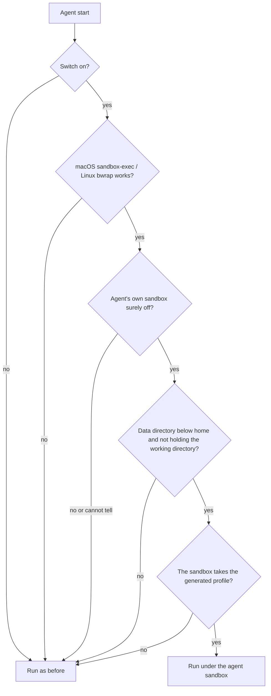

# Agent sandbox

On macOS, the agents Persona starts can run under `sandbox-exec` with everything allowed except the data directory's
secrets. On Linux, bubblewrap (`bwrap` 0.8.x) provides the same default-allow model with user and mount namespaces.
It is off until you turn it on.

An agent in the sandbox keeps the network, the home directory, git, ssh and compilers (and the Keychain on macOS). It
cannot open `secret.key`, `hub.json` or the other credential files through the masked data-directory paths and their
configured aliases, including from a child process or a symlink re-resolved inside those views. Pre-existing hard links
and additional bind mounts are different paths outside this boundary; see the Linux limitations below.

## It closes the data directory's secrets to the agents Persona starts

Except where a row names a platform gap, every row below fails inside the sandbox and works outside it
(`TestDarwinAgentSandboxForReal` and `TestLinuxAgentSandboxForReal` check each applicable one).

| An agent tries to | Result |
| --- | --- |
| Read or copy `secret.key`, `handles.key`, any other `*.key` at the top, `hub.json`, `link.json`, a TLS key | Refused, also through `~/.persona`, a symlink elsewhere, or a child process such as Python or `cp` |
| Read a backup or a copy being written (`secret.key.bak`, `hub.json.bak`, the `hub.json.tmp-*` file a rewrite renames into place) | Refused |
| Read the Cloudflare tunnel token (`relay-tunnel.token`), the Postgres password (`docker/db-password`), or any other `*.token` / `*.secret` / `*.password` at the top of the data directory | Refused |
| Read a manager's folder (`managers/`) or an extension's sign-in data (`extensions/data/`) | Refused |
| Read another launcher's merged settings in `launcher-settings/` | Refused; the files this start passes to its own agent stay readable |
| Connect to an extension's proxy socket or the hub's edge socket (`extensions/run/`, `run/`) | Refused |
| Rename the data directory, a folder above it, or `extensions/` (which holds `extensions/data/` and `extensions/run/`) | Refused, so the secrets cannot be moved out from under the rules (#6117) |
| Replace the `~/.persona` link | Refused on macOS. **Not yet denied on Linux**: stock bwrap cannot filter unlink/rename by path while leaving the link's parent directory writable; see the Linux section |
| Remove the switch file `agent-sandbox.on` | Refused |
| Read `launch.key`, which `personad launch` needs before the node hands out a managed launcher's settings (`launcher.env` on `node.sock`, #5588) | Refused, so the node refuses an agent any launcher's settings |

On macOS, a listing such as `ls -l ~/.persona` still shows the secret files' names, sizes and times; only their contents
are closed. Linux's masked view omits those entries from the listing instead, and opens fail with `ENOENT` rather than a
permission error. At startup, Persona's own files are usable on both: `node.sock` (hooks and MCP), `mcp.json`,
`claude-settings.json`, `bin/`, the assistant's directories, the knowledge base in `data/`, and `personad` itself.
Linux's view is a snapshot: **after a node restart, its sandboxed agents must also be restarted**. An atomically replaced
`node.sock` remains bound to the old inode, and a new public file at the data directory's top is absent. Files created
inside an already-bound directory such as `data/` remain visible.

## Some ways to the secrets stay open

The sandbox covers only the processes Persona starts in it. These reach the secrets anyway:

- **Docker.** An agent that can run `docker` can mount the data directory into a container and read it there.
  `personad hub setup` runs Postgres in Docker, so Docker is there on most hub machines. Closing the Docker socket
  would take Docker away from every agent, so the sandbox leaves it open.
- **Terminals and scripts you start yourself**, and agents Persona does not start: Paseo, DSH and other runtimes,
  daemons, botmux, sessions Herdr App or Orca open themselves, the Codex desktop app.
- **Starts this version does not wrap**: an agent started in herdr or Orca, or resumed after herdr restarts, by a
  launcher other than `personad launch` (plain `claude`, a `~/.zshrc` alias or function); Codex conversations on the
  assistant; a plain `codex` (see "A start is wrapped only when the agent's own sandbox is surely off"). While the
  switch is on, the node records each such herdr or Orca start as `skipped` under `pane`, so the doctor warns; a later
  start there through a managed launcher clears it.
- **Code that runs later outside the sandbox**: files an agent writes for another program to run (shell startup
  files, LaunchAgents, git hooks), and programs outside the sandbox it can drive (`open`, `osascript`, `launchctl`,
  herdr's or tmux's sockets, `ssh localhost`).
- **The hub's API** with a token an agent already has, and **`~/.ssh`** keys.

## Four starts are wrapped

`sandbox.WrapAgent` puts `/usr/bin/sandbox-exec -p <profile>` or `bwrap <mount options> --` in front of the command
and `PERSONA_AGENT_SANDBOXED=1` in its environment. On macOS the process keeps its pid. Stock bwrap keeps a supervisor
process and starts the agent as its direct child; there is no pid namespace, so the node-started bwrap pid is the agent's
`PPID` and both remain visible to the node.

| Start | Started by | Code |
| --- | --- | --- |
| The assistant's Claude on the CLI with plain `claude` or a `~/.zshrc` launcher, guests included | the node | `assistantCLICommand`, `server/internal/node/assistant_start.go` |
| The assistant's Claude on the Agent SDK: the bridge and the claude it starts | the node | `sdkCommand`, `server/internal/node/assistant_sdk.go` |
| A managed launcher, `personad launch <name>`: in herdr, for the assistant, and when the node checks a launcher | a pane's shell, or the node | `launchExec`, `server/internal/node/managed.go` |
| A Codex started from the phone, `personad codex-start` | the pane's shell | `codexStartExec`, `server/internal/node/codex_start.go` |

`personad launch` itself stays outside the sandbox: it reads `launch.key` and fetches the launcher's settings from the
node first, then wraps only the agent it execs. So for a managed launcher the assistant does not wrap its shell, and
`personad launch` wraps the claude it starts. A start inside the sandbox (`PERSONA_AGENT_SANDBOXED=1` in its
environment) runs as it is: the sandbox is inherited, and a second outer sandbox is not applied.

## A start is wrapped only when the agent's own sandbox is surely off

On macOS, `sandbox-exec` cannot apply a profile inside another one that denies anything: the inner one exits 71 with
`sandbox_apply: Operation not permitted`. Claude Code's own sandbox and Codex's `read-only` and `workspace-write` modes
use it. On Linux their user/mount namespaces can likewise conflict with bwrap's. The same surely-off detection is used
on both systems: when Persona cannot tell, it does not wrap, and the doctor says why.



Every "Run as before" except the first records why (`skipped`, `unsupported` or `unavailable`) for the doctor.

- **Claude** is wrapped when nothing sets `sandbox.enabled` to `true`: `settings.json` in `CLAUDE_CONFIG_DIR` or
  `~/.claude` (on the node, in every Claude config directory it knows), `.claude/settings.json` and
  `.claude/settings.local.json` in the working directory and each folder above it,
  `/Library/Application Support/ClaudeCode/managed-settings.json` and `managed-settings.d/`, and `--settings`. A file
  that is there but cannot be read counts as on.
- **Codex** is wrapped when it runs `danger-full-access` in its own process. A plain `codex` 0.163 runs its tools in the
  shared app-server daemon, which wrapping the terminal UI does not reach, so the launcher needs one of the flags that
  keep it in its own process (`-c`, `-p` and the rest of `codexConfigFlags`). The mode is read in Codex's order:
  `--dangerously-bypass-approvals-and-sandbox`, `-s` or `--full-auto`, the profile's `sandbox_mode`, `-c sandbox_mode`,
  then `config.toml` in `CODEX_HOME`. A project's `.codex/config.toml`, `/etc/codex/managed_config.toml` or
  `requirements.toml`, a profile written as a dotted key, and `--remote` all count as cannot tell.
- **Other agents** (`agy` and the rest) are not wrapped until their own sandboxes have been checked.

The data directory check exists because the rules match names in it: with `PERSONA_HOME=~` they would reach every
`hub.json` or `*.pem` in the home's top level. Persona's own working directories inside it (`assistant/`, `health/`,
`guest/`) are fine.

## The rules close names at the top of the data directory and a few folders whole

### macOS: name-based denials

The profile starts from `(allow default)` and adds denials, all on real paths (`/tmp` is `/private/tmp`); each name the
data directory goes by is resolved and written once.

| Rule | Covers |
| --- | --- |
| Read and write, by the start of the name, with an optional leading dot, and anything inside a folder by such a name | `identity.DataSecrets` at the top: `hub.json`, `link.json`, `tailcat.json`, `tailcat-hub.json`, `daemons.json`, `manager.json`, `apns`, `relay.json`, `relay.secret`, `relay-tunnel.token`, `devices.json`, `mail_accounts.json` |
| Read and write, key and credential files with their backups | `identity.DataCredentialPattern` at the top: `\.(key|p8|pem|crt|token|secret|password)([.~-][^/]*)?$` |
| Read and write, whole folders | `identity.DataSecretDirs` (`launcher-settings/`, `tls/`, `link-tls/`, `docker/`, `extensions/data/`, `extensions/staging/`, `plugins/`, `node-plugins/`), and `managers/`, `extensions/run/`, `run/`; connecting to the sockets in `extensions/run/`, `plugins/run/` and `run/` |
| Connect | Unix sockets under `extensions/run/` and `run/` |
| Write | The data directory itself, every folder above it, its other names (the `~/.persona` link), every folder in it that holds a closed folder (`extensions/`), `agent-sandbox.on` |
| Allow read | This start's own files in `launcher-settings/` (what it passes with `--settings`) |

The node's path guard (`server/internal/node/pathguard.go`, which decides what a phone or web client may read by path)
takes the same list from `server/internal/identity/secrets.go`. They differ here, and `TestAgentSandboxCoversPathGuard`
pins each difference:

| Path in the data directory | Path guard | Agent sandbox |
| --- | --- | --- |
| `managers/<id>/` | The same names, keys and folders at its top | The whole folder |
| `.hub.json.*` and other dot-prefixed copies | Readable | Refused |
| `extensions/run/`, `run/` | Readable | Refused, sockets included |
| This start's own launcher settings | Refused | Readable |
| A manager's folder outside the data directory (`--dir`, one holding a manager's `manager.json`) | The same names, keys and folders at its top | Not closed |

Neither matches a name deeper in the data directory, so a project's own `link.json` or `certs/dev.pem` below it stays
readable.

### Linux: masked data-directory views

`AgentProbe` first finds `bwrap` on `PATH`, then really runs `true` with `--unshare-user` and the default-allow root and
`/dev` mounts. A missing binary, a locked-down unprivileged user namespace, or a failed mount reports `unavailable`
with the error; a binary on `PATH` alone is not support. Linux does not cache this probe or the full-profile preflight:
installing, removing or replacing bwrap and a namespace recovery are observed on the next start, and different working
directories do not accumulate profile keys. Every real start runs `true` with every generated mount before the agent.

The agent profile is deliberately not the extension sandbox's whitelist. It starts with a read-write bind of `/` and a
`--dev-bind /dev /dev` (ordinary tools need `/dev/null`), uses `--unshare-user`, and does **not** unshare the network,
pid or IPC namespace. Home, the working directory, git, ssh, compilers and network connections stay on the host view.

For every resolved data directory, the profile then:

- mounts a tmpfs at the directory and binds back each existing entry whose top-level name is not closed by
  `identity.DataSecretName` (which combines `DataSecrets` and `DataCredentialPattern`), including the optional leading
  dot used for temporary copies. `agent-sandbox.on` is bound read-only, so it stays visible but cannot be removed or
  replaced;
- leaves out `identity.DataSecretDirs`, `managers/`, `extensions/run/` and `run/`. A directory that only partly contains
  closed paths, such as `extensions/`, gets its own partial view; `launcher-settings/` gets one containing only this
  start's own settings, bound read-only;
- recreates an ordinary allowed symlink with `bwrap --symlink` and its original target rather than bind-mounting the
  target. Opening it therefore resolves through the masked view again. A symlink for the switch or an allowed launcher
  settings file is closed, as is a symlink at a closed or partially closed directory such as `extensions/`;
- remounts each view root read-only without remounting its allowed children. Existing knowledge-base, assistant, bin,
  socket and other allowed entries remain writable where their host permissions allow, but a new secret, backup or
  dot-prefixed copy cannot be created at the data directory's top;
- captures the enumerated top-level entries and each file's inode at startup. A host-side atomic `node.sock` replacement
  stays on the old socket in the running sandbox, and a new top-level public file is absent. Restart the sandboxed agent
  with the node; files below an existing directory bind, such as `data/`, are not snapshots;
- bind-mounts every ancestor of the real data directory onto itself. Renaming the data directory, an ancestor or a
  partial-view directory such as `extensions/` fails with `EBUSY`, while writes inside allowed children still work.

An explicit symlink name for the data directory receives the same masked view, so neither that name nor a symlink
elsewhere can read a secret. The closed socket directories are absent from every view: connecting to their sockets
fails because the path does not exist, not because bwrap filters the `connect` syscall. The rest of the network stays
available.

**Linux gap: replacing the data-directory symlink is not denied.** Mount namespaces can make a directory mount point
unmovable, but bwrap has no path-aware unlink/rename rule for a symlink whose parent (usually the home directory) must
remain writable. Making the whole home read-only or replacing it with a tmpfs would break the default-allow contract,
so this slice does not pretend to enforce that one macOS row. Closing it needs a path-aware follow-up mechanism rather
than more bwrap mount flags. The real data directory and its ancestors are still protected, and replacing the link does
not expose the secrets in the running sandbox.

### Linux path, namespace and scale limits

- **Pre-existing hard links are outside the path boundary on both macOS and Linux.** A hard link outside the configured
  data-directory paths still opens the same inode. The hidden path cannot be used to create a new hard link inside the
  sandbox, but the profile cannot discover links that already exist elsewhere.
- **An additional bind mount of the data directory is outside the path boundary on both macOS and Linux.** Explicit
  configured aliases are resolved and protected, but neither platform's profile discovers every pre-existing bind alias
  from the mount table. On Linux such an alias bypasses the tmpfs view; on macOS it is another name the path rules do
  not match. Add every such path to the configured data directories or avoid the alias; “masked paths” does not mean
  every mount of the same directory.
- **Concurrent source replacement is not claimed to be safe.** Paths are enumerated before preflight and resolved again
  by bwrap at the real start; an outside process that can replace those sources has a TOCTOU window. Closing it needs
  `O_NOFOLLOW` descriptors carried into `--bind-fd` / `--ro-bind-fd`, not another pathname check.
- **A view has a size limit.** Stock bwrap 0.8 rejects more than 9000 arguments including the agent command. Roughly
  3000 ordinary top-level entries reach it without an alias, and each explicit alias duplicates its view's arguments.
  Persona checks the complete count before preflight and refuses to wrap with a clear reason instead of starting bwrap
  and failing with its generic argument error. Large views also pay for every mount twice (preflight and real start).
- **The two tested namespace escape hypotheses stayed closed on Linux 5.15 / bwrap 0.8.0.** Reading
  `/proc/<same-UID-pid>/root/<data directory>/secret.key` returned `Permission denied`. A nested `unshare -rm` reached
  its shell, but the masked path was `not mounted` for `umount` there and the secret remained `ENOENT`.
  `TestLinuxAgentSandboxNamespaceBoundariesForReal` runs both with unmasked controls; this is host-specific evidence,
  not a guarantee for every kernel and procfs configuration.

## Known side effects

- **On macOS, setuid programs do not start**: `ps`, `top`, `sudo`, `su` and `crontab` fail with `Operation not
  permitted`. `pgrep` and `lsof` work.
- **`personad launch`, `personad extension …` and `personad hub admin …` fail in an agent**: they read `launch.key` or
  the hub's token in `hub.json`.
- **Each wrapped profile runs once more with `true`**, through `sandbox-exec` or bwrap, to check the rules before the
  real start. macOS remembers the answer for the same rules; Linux deliberately preflights every start so removal of
  bwrap or a namespace failure cannot leave a stale `active` status.

## The switch is a file in the data directory

Turn it on or off for every process on the machine with the file, then start the agent again; running agents keep how
they started. Before you turn it on: it does not stop Docker (see "Some ways to the secrets stay open"), it does not
cover agents started in herdr or Orca without a managed launcher, and on macOS `ps`, `top` and `sudo` stop working in
agents. On Linux, restart the sandboxed agents whenever the node restarts so their `node.sock` and top-level view are
refreshed. `personad node doctor` repeats the relevant limitations while the sandbox is on.

```sh
touch ~/.persona/agent-sandbox.on   # on (use PERSONA_HOME's directory for a custom root)
rm ~/.persona/agent-sandbox.on      # off
```

`PERSONA_AGENT_SANDBOX` (`on` or `off`, also `1`, `0`, `true`, `false`) overrides the
file for the process that reads it. Each start reads it in a different place:

| Start | Reads the variable from |
| --- | --- |
| The assistant, CLI and Agent SDK | The node's environment: for the resident node, `EnvironmentVariables` in its LaunchAgent (`~/Library/LaunchAgents/com.persona.node.plist`), read when the node restarts |
| `personad launch`, `personad codex-start` | The shell of the herdr or Orca pane (the node's, when the node checks a launcher) |
| `personad node doctor` | The terminal it runs in |

A `PERSONA_HOME` set only for the node does not reach a pane's shell, which then looks for the file in
`~/.persona`. Configure the same `PERSONA_HOME` in both the resident node's LaunchAgent and the pane's shell when using a custom root.

## When something breaks, turn it off and start again

1. Run `personad node doctor`. The `agent-sandbox` line says whether the sandbox is on, whether this machine can run
   it, and the last result of each kind of start, with the reason when a start was not wrapped.
2. Remove `agent-sandbox.on`, or set `PERSONA_AGENT_SANDBOX=off` for one shell, and start the agent again. Nothing else
   changes: no data moves and no file is rewritten.

A start the sandbox cannot set up runs unwrapped: the agent starts as before, and the reason goes to the pane
(`personad launch: agent sandbox: … not wrapped`) or the node's log, and to `agent-sandbox-status.json` in the data
directory, which the doctor reads.

## Real sandbox tests

`TestDarwinAgentSandboxForReal` (`server/internal/extension/sandbox/agent_test.go`) and
`TestLinuxAgentSandboxForReal` (`agent_linux_test.go`) run shell commands under the real profile in a fake data
directory and check both what must fail and what must work. Each has an unmasked control for the must-fail commands.
The Linux matrix also covers a secret created after profile generation, view-internal file and directory symlinks (both
closed and ordinary working links), all closed directories, local network access when curl is present, ssh and a
compiler when present, and the direct bwrap-parent/agent-child pid relationship. The alias-replacement gap is exercised
separately with assertions that both real and alias paths still hide the secret.
`TestLinuxAgentSandboxSnapshotForReal` replaces a socket after bwrap is ready and proves the old/new inode behavior;
`TestLinuxAgentSandboxNamespaceBoundariesForReal` covers `/proc/<pid>/root` and nested unshare/umount. Lifecycle tests
cover probe recovery, bwrap removal, 120 different working directories with no profile cache, and the 9000-argument
early refusal.

Run them locally in `server/`:

```sh
go test ./internal/extension/sandbox/ -run ForReal -v
```

The Darwin test skips elsewhere (CI has no macOS runner). The Linux test skips when bwrap or its user-namespace probe
is unavailable; run it on stock bubblewrap 0.8.x after changing the profile. Apple marks `sandbox-exec` deprecated and
does not document its profile language, so run the Darwin test after a macOS update.
